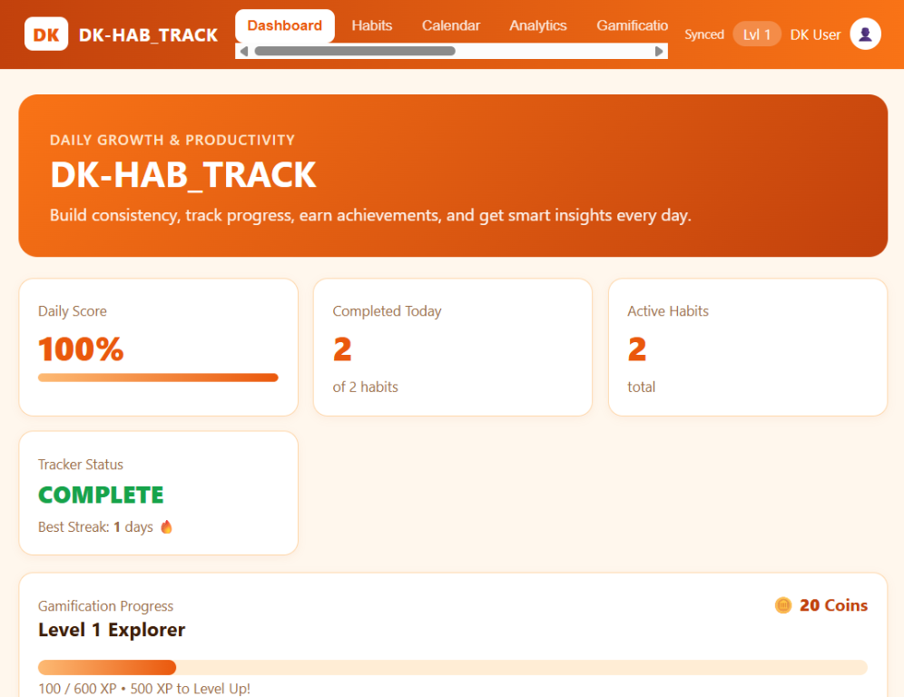
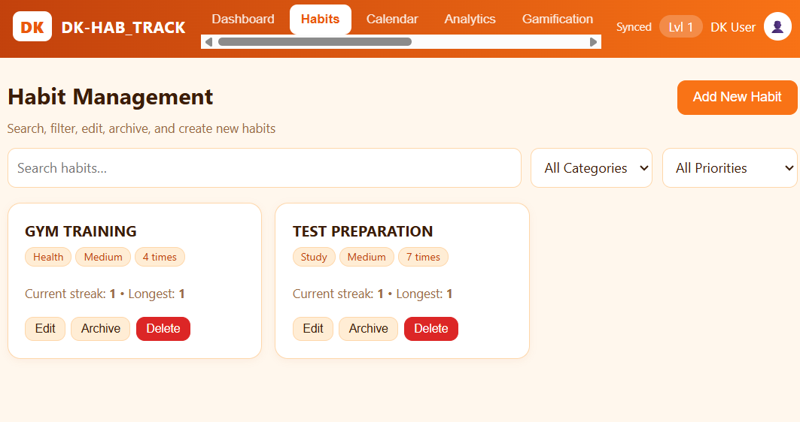
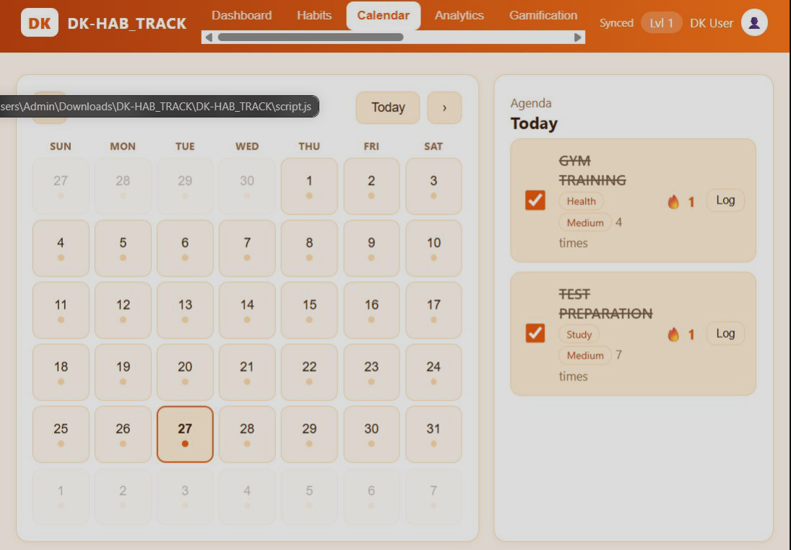
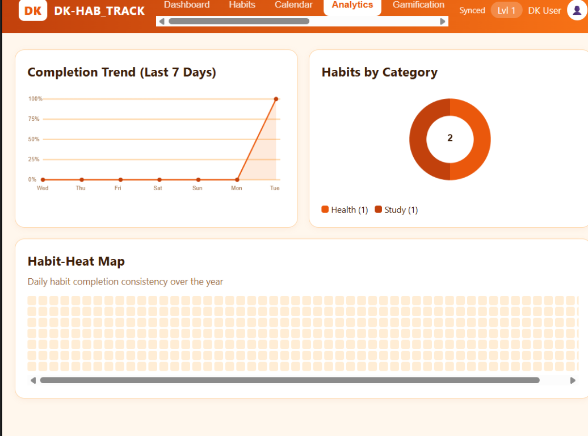
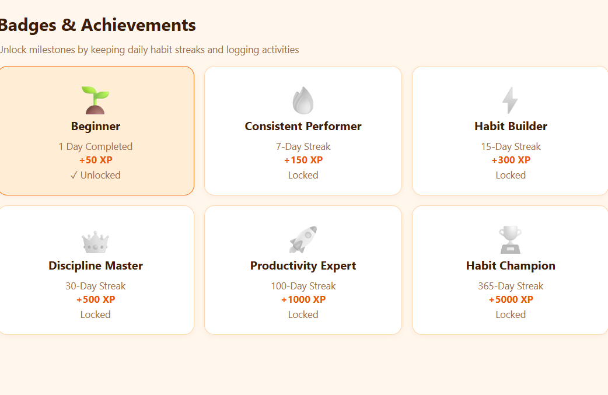
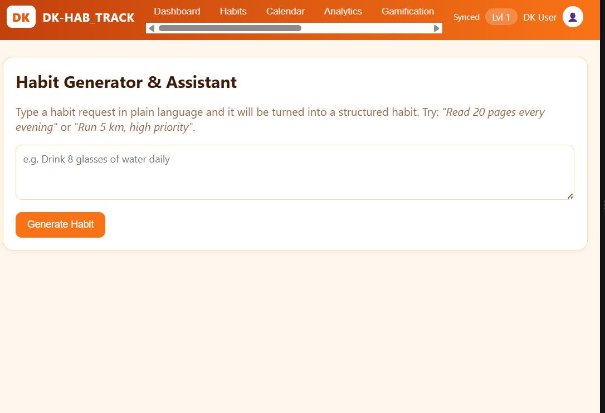

# DK-HAB_TRACK

DK-HAB_TRACK is a habit and productivity tracker for building daily routines. Track habits, monitor streaks, earn XP and badges, log your mood, and review your progress in one place.

The app uses plain HTML, CSS, and JavaScript for the frontend, with a small Python Flask API and SQLite database for persistence.

## Screenshots

### Dashboard


### Habit management


### Calendar and daily agenda


### Analytics


### Badges and achievements


### Habit generator


## Features

| Section | What it does |
|---|---|
| Dashboard | Daily completion score, active habits, streaks, XP, coins, insights, and recent activity |
| Habits | Create, edit, archive, restore, delete, search, and filter habits |
| Calendar | Browse a monthly calendar and review or update a selected day's habit agenda |
| Analytics | See the last seven days of completions, habits by category, and a yearly heat map |
| Gamification | Earn streak badges, 50 XP, and 10 coins for each completion; gain a level every 600 XP |
| Mood & Journal | Record a daily mood and save a journal entry |
| Habit Generator | Parse a plain-language request into a suggested habit; works offline and is rule-based |
| Reports | Review habit logs, export CSV, and print a PDF summary |
| Settings | Switch themes, change the display name, and reset app data |

## Requirements

- Python 3.9 or newer
- pip
- A modern web browser

## Run locally

Open a terminal in the project folder and run:

```powershell
python -m pip install -r requirements.txt
python app.py
```

Then open [http://127.0.0.1:5000](http://127.0.0.1:5000) in your browser. Keep the terminal window open while using the app; press `Ctrl+C` there to stop the server.

## Run the tests

```powershell
python -m unittest -v test_app
```

## Data and privacy

The backend stores the app's current state in `habit_tracker.db` in the project folder. The browser also keeps a local copy in `localStorage` under `dk-hab-track-v1` for use when the backend is unavailable. The app syncs changes to the backend when connected.

The server listens on `127.0.0.1` and is intended for local, single-user use. It does not provide user accounts or authentication and should not be exposed to the public internet as-is. Use **Settings > Reset** to clear the app data.

## Project structure

```text
DK-HAB_TRACK/
├── app.py                 # Flask routes and SQLite persistence
├── habit_tracker.db       # Created at runtime to store app state
├── index.html             # App layout and views
├── script.js              # State, interactions, charts, and exports
├── style.css              # Light and dark orange themes
├── requirements.txt       # Python dependencies
├── test_app.py            # Backend API tests
├── screenshots/           # README screenshots
└── README.md
```

## Notes

- The assistant that generates habits is a local keyword and regular-expression parser, not a language model.
- Streaks count consecutive completed days through today.
- The PDF summary opens a print-ready page. Choose **Save as PDF** in the browser's print dialog.

## Author

DK
